<p align="center">
  
</p>

# Canary

**Leave auto-run on. Canary blocks the handful of shell commands you can't undo.**

A local command-hook guardrail for coding agents. It scans your repository for agent-related risks and installs a pre-execution hook in Claude Code, Codex, Cursor, Gemini CLI, or OpenCode. The hook stops recursive deletes it cannot resolve, destructive database commands against non-local hosts, force pushes, and infrastructure changes applied with `-auto-approve`. Everything else runs without a prompt. It is a seatbelt, not a security boundary.

[](https://github.com/eyesopen21/canary/actions/workflows/test.yml)
[](LICENSE)
[](https://nodejs.org)
[](#choose-your-agent)
[](package.json)

[The idea](#the-idea) · [What it stops](#what-it-stops) · [Choose your agent](#choose-your-agent) · [Start here](#start-here) · [Limits](#what-canary-protects-and-what-it-does-not) · [Documentation](#documentation) · [Contribute](#development-and-contributions) · [Report an issue](https://github.com/eyesopen21/canary/issues/new)

Canary is not published to npm yet. Install it from this checkout; the steps are in [Start here](#start-here).


## The idea

**Auto-run is what makes coding agents fast, and one misresolved command is what makes it expensive.** An empty variable in `rm -rf "$DIR"/build`, a `DATABASE_URL` that points at the wrong host, or a force push on the wrong branch cannot be undone from your machine.

Canary does not ask you to turn auto-run off. It narrows the question to the commands you cannot take back. The hook evaluates each shell command before it runs, lets safe ones through without a prompt, and blocks the irreversible ones with a message that names the danger, the consequence, and what to do instead.

The decision path has no LLM, makes no network calls, and never prints a secret value. The same input gives the same result, so the policy can be tested, reviewed, and trusted. Where Canary cannot protect you, it says so in public: the [threat model](docs/THREAT-MODEL.md) and the [live-check runbook](docs/testing/live-agent-checks.md) list what is out of scope and what failed.

**Best fit.** A founder or "vibecoder" running an agent in an auto-run or YOLO mode on a laptop with no second reviewer. Cursor is the clearest case: its `preToolUse` hook supports `failClosed: true` [S9], and a live `--yolo` pass is recorded.

**Anti-fit.** Teams that need an enforceable enterprise control or a certified boundary, which a local hook is not; and agents with no compatible project command hook (for example Replit, which is not one of the five adapters).

## What it stops

### 1. A recursive delete that cannot be resolved

**For when a variable is empty, a glob expands somewhere unexpected, or a link points outside the project.** Canary blocks recursive deletes (`rm -rf`, `rimraf`, `Remove-Item -Recurse`, `find -delete`) whose target contains a variable, a command substitution, an unsafe glob, or a path that resolves outside the project root. It fails closed: if the target cannot be checked, the command does not run.

**Value:** the one deletion that takes your home folder with it never starts.

### 2. A destructive database command against a non-local host

**For when `DATABASE_URL` points at something that is not your laptop.** Canary blocks `DROP`, `TRUNCATE`, `DELETE` without `WHERE`, and schema migrations or resets from common tools when the configured host is not local. It reports the variable name and the classification, never the URL or the host.

**Value:** a test run cannot wipe a shared or production database.

### 3. A force push

**For when history is shared.** Canary blocks `git push --force`, `-f`, `--mirror`, and `+refspec` pushes. `--force-with-lease`, `git reset --hard`, and destructive `git clean` flags produce a warning instead of a block.

**Value:** commits that exist only on the remote are not overwritten.

### 4. An infrastructure change nobody reviewed

**For when the plan is skipped.** Canary blocks `terraform` and `tofu` `apply` or `destroy` run with `-auto-approve`.

**Value:** a human sees the plan before live resources change.

### 5. Risks in the repository, before the agent runs

**For when you want to know what an agent could break here.** `canary scan` runs five offline checks and writes a score and findings without secret values: non-local test databases, committed credentials, unguarded recursive deletes in scripts, unpinned MCP servers and permission-bypass flags and hidden Unicode in rule files, and CI workflows that run an agent on untrusted input.

**Value:** the worst risks first, with a fix or a manual step for each.

### See it block

This is real output from the live checks on 22 Nov 2026, as the agent reported it:

```text
Canary blocked a recursive delete. Danger: the target `"$EMPTY"/sentinel` contains a variable
or command substitution that Canary cannot resolve before it runs. Consequence: if it expands
to an empty or wrong path, the command deletes files outside the intended folder, and they
cannot be restored from this machine. Instead: use a literal path inside the project.

Canary blocked a force push. Danger: this push rewrites history on `sandbox-origin`.
Consequence: commits that exist only on `sandbox-origin` are lost for everyone who uses it.
Instead: push without forcing, or ask a human to approve a force push.
```

The exact rules and the text of every message are in the [hook policy](docs/specs/policy.md).

## Choose your agent

One core decides, and a thin adapter per agent translates its hook format. Hook interfaces are documented in [S1][S8][S9][S10][S11][S14]. Evidence and run notes are in the [runbook](docs/testing/live-agent-checks.md#results).

| Agent | Live AC-4 result |
| --- | --- |
| Claude Code | **Pass** |
| Codex | **Pass** |
| Cursor | **Pass** |
| Gemini CLI |**Pass** |
| OpenCode | **Pass**|

### Hook and install

| Agent | Hook | Install |
| --- | --- | --- |
| Claude Code | `PreToolUse` in `.claude/settings.json` | `canary init --agent claude-code` |
| Codex | `PreToolUse` in `.codex/hooks.json` | `canary init --agent codex`, then review and trust the hook with `/hooks` |
| Cursor | `preToolUse` in `.cursor/hooks.json` | `canary init --agent cursor` |
| Gemini CLI | `BeforeTool` in `.gemini/settings.json` | `canary init --agent gemini-cli` |
| OpenCode | `permission.evaluate` plugin in `.opencode/plugins/canary/` | `canary init --agent opencode` |

### How each hook fails

| Agent | Failure behavior |
| --- | --- |
| Claude Code | Configured with `onFailure: "block"`. |
| Cursor | Configured with `failClosed: true`. A live normal-deny pass is recorded; hook-error fallback is unverified. |
| Codex | **Fail-open:** a hook error, timeout, or malformed response can let the command run [S8]. |
| Gemini CLI | **Fail-open:** non-JSON output or an unsupported exit code can let the command run [S10]. |
| OpenCode | Fail-open behavior is unverified. Do not assume a hook failure blocks the command. |

The distributable manifests are `hooks/claude-code.json`, `hooks/codex.json`, and `hooks/hooks.json` for the Gemini CLI extension. `canary init` generates the project configurations listed above.

## Start here

### Install from this checkout

You need Git, npm, and Node.js 22.22 or later. Build and pack the checkout, then install the tarball globally:

```sh
npm pack
npm install --global ./eyesopen21-canary-0.1.0.tgz
canary --help
```

The generated hook configurations call `node` with an absolute path to the package's built entry, so the npm global bin directory does not need to be on the agent's `PATH`. Node.js itself must be available when the agent runs hooks. The build emits JavaScript into `dist/` with Node's built-in TypeScript type stripping and adds no dependencies; see [ADR-0006](docs/decisions/0006-zero-dependency-typescript-on-node.md) and [ADR-0007](docs/decisions/0007-commit-built-javascript-for-marketplace-installs.md).

### Three steps

```sh
# 1. Read-only repository scan. Writes canary/findings.json (no secret values).
canary scan

# 2. Preview the configuration diff, then install the hook for one agent.
canary init --agent cursor

# 3. See what the hook stops, in an isolated temporary copy.
canary crash-test
```

`canary init` previews the full diff before writing. The preview omits unchanged existing values and redacts sensitive values. It reminds you that Node.js must be available when hooks run, reports where a hook failure can let commands proceed, and, for Codex, tells you to review and trust the project hook with `/hooks` before it runs [S8]. The crash test runs its destructive demonstrations only inside a fresh OS temporary directory ([ADR-0004](docs/decisions/0004-crash-test-isolation.md)); the database scenario is a simulation and makes no connection.

### Commands

| Command | Behavior |
| --- | --- |
| `canary scan` | Scans the current repository, prints a summary, and writes `canary/findings.json`. |
| `canary scan --json` | Prints scan findings as JSON. |
| `canary scan --badge` | Also writes `canary/badge.svg`. |
| `canary badge` | Writes the score badge from the existing findings report. |
| `canary init --agent <name>` | Shows a diff and writes hook configuration for `claude-code`, `codex`, `cursor`, `gemini-cli`, or `opencode`. |
| `canary hook --agent <name>` | Reads one agent hook event from stdin and returns that adapter's decision. Normally called by the agent. |
| `canary crash-test` | Demonstrates three guarded destructive-command scenarios in an isolated temporary copy. |

## What Canary protects and what it does not

| Canary does | Canary does not |
| --- | --- |
| Blocks recursive deletes it cannot resolve, destructive database commands against non-local hosts, force pushes, and `-auto-approve` infrastructure changes. | Stop the same effect reached through a script, an interpreter, or another tool. The hook sees the command text it is given. |
| Warns on `git push --force-with-lease`, `git reset --hard`, and destructive `git clean`. | Protect an agent session where the hook is not loaded, or an agent or person who deliberately bypasses it. |
| Scans repository content and selected local configuration, offline. | Inspect cloud accounts or prove what a cloud credential can access. |
| Keeps secret values out of every output, with a test for it. | Replace operating-system isolation, restricted credentials, backups, or branch protection. Use them alongside Canary. |
| Fails closed on destructive input it cannot resolve. | Stop an attacker with access to your machine. |

Known gaps are listed in the [policy](docs/specs/policy.md#known-gaps) and [open questions](docs/open-questions.md#open-questions-about-the-agents): effects hidden in scripts, interpreters, or other tools; file-write and MCP tools; database tools outside the B2 list; hosts classified as local that are still shared; and hook failures on agents that fail open. The score is a heuristic, not a certification or an audit opinion. The full analysis, with ten threats and their mitigations, is in the [threat model](docs/THREAT-MODEL.md) and [ADR-0002](docs/decisions/0002-hook-is-one-layer-not-the-boundary.md).

**Alternatives, named without comparative testing.** Native agent permissions and deny rules [S2][S16][S26], sandboxes or devcontainers, not using auto-run, backups and branch protection, and other hook projects (Arcjet, Rollcage Guard, Jarvy, Harbor). No head-to-head comparison was run. Canary is a narrow local hook, not a replacement for them.

## Documentation

| Document | Contents |
| --- | --- |
| [docs/SRS.md](docs/SRS.md) | Requirements, acceptance criteria, and traceability |
| [docs/specs/policy.md](docs/specs/policy.md) | Hook rules, exact messages, and privacy limits |
| [docs/specs/agent-adapters.md](docs/specs/agent-adapters.md) | Adapter contracts and generated configurations |
| [docs/testing/live-agent-checks.md](docs/testing/live-agent-checks.md) | Live-check runbook and recorded results, including failures |
| [docs/THREAT-MODEL.md](docs/THREAT-MODEL.md) | Threats, mitigations, and residual risk |
| [docs/decisions/](docs/decisions/) | Architecture decisions |
| [docs/open-questions.md](docs/open-questions.md) | Assumptions and items that remain unverified |
| [docs/sources.md](docs/sources.md) | External sources cited by the docs |

## Development and contributions

```sh
npm test            # unit, contract, packaging, and isolation tests
npm run build       # emits dist/ from src/
npm run bench       # hook latency report, with the Node startup floor
```

The core in `src/core/` holds the checks, policy, messages, and score. Each agent adapter in `src/adapters/` only translates input and output. A policy change updates [docs/specs/policy.md](docs/specs/policy.md) and `openspec/specs/hook-policy/spec.md` together. Read [CONTRIBUTING.md](CONTRIBUTING.md) before opening a pull request and [AGENTS.md](AGENTS.md) if an agent is making the change. Report vulnerabilities as described in [SECURITY.md](SECURITY.md), not in public issues.

## Origin and status

The product scope follows an AI-safety-audit prompt described in the design notes [S24]. Its provenance and author affiliation are not independently verified in this repository, the prompt text is not published here, and no institutional affiliation is claimed. The npm package is not published, and marketplace submission is planned, not done ([assumptions A1 to A3](docs/open-questions.md#assumptions)).

## Acknowledgements

Built for the Dojo AI Hackathon, Track 01. The documentation layout follows Dojo Coding Labs' [remotion-superpowers](https://github.com/DojoCodingLabs/remotion-superpowers) and [hacienda-cr](https://github.com/DojoCodingLabs/hacienda-cr) [S22][S23]; no text was copied.

## License

[MIT](LICENSE)
