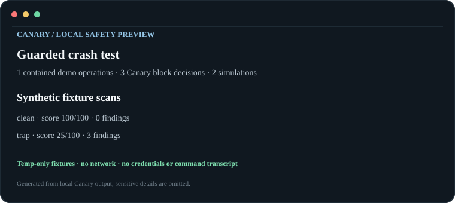

# Canary

Canary scans a repository for selected agent-related risks and provides a command hook that blocks a small set of destructive shell commands. It is a local guardrail, not a security boundary.



The repository contains a working local CLI and adapters for Claude Code, Codex, Cursor, Gemini CLI, and OpenCode. One live AC-4 pass is recorded (Cursor); Codex failed its live check and is listed as unsupported, and the other three remain unverified or inconclusive:

| Agent | Live AC-4 result |
| --- | --- |
| Claude Code | **Unverified** |
| Codex | **Unsupported** (live 2026-11-22: force push executed because `codex exec --trust` does not trust the non-managed hook; see [runbook](docs/testing/live-agent-checks.md#codex-q2-root-cause-2026-11-22)) |
| Cursor | **Pass** (live 2026-11-22: Canary blocked both commands; see [runbook](docs/testing/live-agent-checks.md#results)) |
| Gemini CLI | **Unverified** |
| OpenCode | **Unsupported** (live 2026-11-22: sentinel delete executed with no Canary decision; force push denied by the generated `opencode.jsonc` rule, not Canary; see [runbook](docs/testing/live-agent-checks.md#results)) |

Do not change a status until a human has completed and recorded that agent's run in [the live-agent runbook](docs/testing/live-agent-checks.md). See also [open questions](docs/open-questions.md) and [agent adapters](docs/specs/agent-adapters.md).


## Install from this checkout

Canary is not published to npm. With Git, npm, and Node.js 22.22 or later, build and pack this checkout, then install the generated tarball globally:

```sh
npm pack
npm install --global ./eyesopen21-canary-0.1.0.tgz
```

The generated agent hook configurations invoke `node` with an absolute path to the package's built entry, so the global npm bin directory does not need to be on the agent's `PATH`. Node.js itself must be available when the agent runs hooks. Check with `canary --help` before configuring an agent. The package's build step emits JavaScript into `dist/` using Node's built-in TypeScript type stripping; see [ADR-0006](docs/decisions/0006-zero-dependency-typescript-on-node.md) and [ADR-0007](docs/decisions/0007-commit-built-javascript-for-marketplace-installs.md).

## Quick start

```sh
# Read-only repository scan; writes canary/findings.json.
canary scan

# Preview Canary's configuration changes, then install a hook for one agent.
canary init --agent claude-code

# Run isolated destructive-command demonstrations.
canary crash-test
```

`canary init` previews the full diff of Canary's changes before writing. The preview omits unchanged existing values and redacts sensitive values. It prints a reminder that Node.js must be available when hooks run; it also reports where hook failures can let commands proceed. The `crash-test` command is designed to use an isolated temporary directory. Review [the threat model](docs/THREAT-MODEL.md) for scope and limitations.

Supported `--agent` values are `claude-code`, `codex`, `cursor`, `gemini-cli`, and `opencode`.

## Commands

| Command | Behavior |
| --- | --- |
| `canary scan` | Scans the current repository, prints a summary, and writes `canary/findings.json`. |
| `canary scan --json` | Prints scan findings as JSON. |
| `canary scan --badge` | Also writes `canary/badge.svg`. |
| `canary badge` | Writes the score badge from the existing findings report. |
| `canary init --agent <name>` | Shows a diff and writes hook configuration for the selected agent. |
| `canary hook --agent <name>` | Reads one agent hook event from stdin and returns that adapter's decision. Normally called by the agent. |
| `canary crash-test` | Demonstrates three guarded destructive-command scenarios in an isolated temporary copy. |

## Agent configuration generated by `init`

| Agent | Project configuration | Hook interface | Hook failure behavior |
| --- | --- | --- | --- |
| Claude Code | `.claude/settings.json` | `PreToolUse` | Configured with `onFailure: "block"`; live behavior unverified. |
| Codex | `.codex/hooks.json` | `PreToolUse` | Fail-open: a hook error, timeout, or malformed response can let the command run. |
| Cursor | `.cursor/hooks.json` | `preToolUse` | Configured with `failClosed: true`; live behavior unverified. |
| Gemini CLI | `.gemini/settings.json` | `BeforeTool` | Fail-open: non-JSON output or an unsupported exit code can let the command run. |
| OpenCode | `.opencode/plugins/canary/index.ts` and `opencode.jsonc` | V2 permission `evaluate` | Fail-open behavior is unverified; do not assume a hook failure blocks the command. |

The hook interfaces and failure behavior in this table summarize the cited agent documentation: Claude Code [S1][S2][S3], Codex [S8], Cursor [S9], Gemini CLI [S10][S11], and OpenCode [S14][S16]. The repository's distributable manifests use `hooks/claude-code.json` for Claude Code, `hooks/codex.json` for Codex, and `hooks/hooks.json` for the Gemini CLI extension. The CLI-installed project configurations are generated by `canary init` as listed above. Packaging and protocol compatibility still require live-agent verification for each agent.

## What Canary can and cannot protect

The policy blocks recursive deletes whose targets cannot be safely resolved, destructive database commands when the configured host is non-local, force pushes, and infrastructure apply/destroy commands with automatic approval. It warns on selected Git commands. Exact rules and messages are in the [hook policy](docs/specs/policy.md).

Canary only evaluates shell commands that reach its hook. It cannot stop equivalent actions hidden in scripts or other tools, an agent session where the hook is not loaded, an agent or person deliberately bypassing the hook, or an attacker with access to the machine. Its scanner checks repository content and selected local configuration; it does not inspect cloud accounts or prove what cloud credentials can access. Use operating-system isolation, restricted credentials, backups, and other independent controls where needed.

Codex and Gemini CLI document fail-open behavior on hook errors. OpenCode's error behavior is unverified. The `onFailure: "block"` and `failClosed: true` settings are configured for Claude Code and Cursor respectively, but **the blocking behavior has not been confirmed in live agent sessions**. Canary's score is a heuristic, not a certification or audit opinion.

## Documentation

| Document | Contents |
| --- | --- |
| [docs/SRS.md](docs/SRS.md) | Requirements, acceptance criteria, and traceability |
| [docs/specs/policy.md](docs/specs/policy.md) | Hook rules, exact messages, and privacy limits |
| [docs/specs/agent-adapters.md](docs/specs/agent-adapters.md) | Adapter contracts and generated configurations |
| [docs/THREAT-MODEL.md](docs/THREAT-MODEL.md) | Threats, mitigations, and residual risk |
| [docs/decisions/](docs/decisions/) | Architecture decisions |
| [docs/open-questions.md](docs/open-questions.md) | Assumptions and items that remain unverified |
| [docs/sources.md](docs/sources.md) | External sources cited by the docs |

## Contributing and security

Read [CONTRIBUTING.md](CONTRIBUTING.md) before opening a pull request. Report vulnerabilities as described in [SECURITY.md](SECURITY.md).

## License

[MIT](LICENSE)
